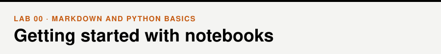

📖 *Business Intelligence and Analytics* · Markdown and Python basics &nbsp;|&nbsp; [All labs](../README.md#labs) · [Lab 01 →](../01-python-and-pandas/)

## Walkthrough

- [Introduction to notebooks](walkthrough/01_intro_to_notebooks.ipynb)
- [Markdown and a first Python function](walkthrough/02_markdown_and_python.ipynb)

## Exercises

Recreate each of the two pages below in your own Colab notebook.

| Exercise | Target | Solution |
|---|---|---|
| 1. A short statistics page (headings, formulas, code) | [exercise_1_target.pdf](exercises/exercise_1_target.pdf) | [Solution](exercises/solutions/exercise_1_solution.ipynb) |
| 2. A company profile (image, links, table, video) | [exercise_2_target.pdf](exercises/exercise_2_target.pdf) | [Solution](exercises/solutions/exercise_2_solution.ipynb) |

Links you will need for exercise 1:

- http://www.statisticshowto.com/mean-squared-error

Links you will need for exercise 2:

- https://upload.wikimedia.org/wikipedia/commons/a/a9/Amazon_logo.svg
- https://www.youtube.com/embed/a9__D53WsUs
- https://en.wikipedia.org/wiki/Prime_Video
- https://en.wikipedia.org/wiki/Twitch_(service)
- https://en.wikipedia.org/wiki/Amazon_Web_Services
- https://www.bbc.com/news/business-55927979
- https://www.independent.co.uk/news/world/americas/jeff-bezos-letter-amazon-b1796716.html

> [!TIP]
> **For instructors.** No dataset is needed. The two exercises ask students to recreate a formatted page; solution notebooks are in `exercises/solutions/`.
