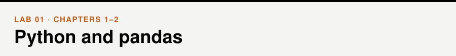
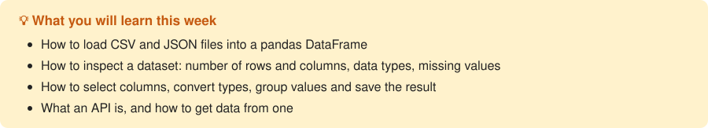

📖 *Business Intelligence and Analytics* · Chapters 1–2 &nbsp;|&nbsp; [← Lab 00](../00-getting-started/) · [All labs](../README.md#labs) · [Lab 02 →](../02-data-cleaning-and-eda/)

## Walkthrough

- [Basic pandas operations](walkthrough/01_pandas_basics.ipynb)
- [Getting data from an API](walkthrough/02_apis.ipynb)

## Exercises

- [Python and pandas](exercises/exercises.ipynb)

## Extra (optional)

- [Python refresher](extra/python_refresher.ipynb)
- [Describing a dataset](extra/dataset_descriptions.ipynb)
- [Selecting data, part 1: [ ], .loc and .iloc](extra/pandas_selection_1_loc_and_iloc.ipynb)
- [Selecting data, part 2: boolean indexing](extra/pandas_selection_2_boolean_indexing.ipynb)
- [Selecting data, part 3: assigning subsets](extra/pandas_selection_3_assigning_subsets.ipynb)
- [Selecting data, part 4: how not to select](extra/pandas_selection_4_how_not_to_select.ipynb)

## Datasets

[`pandas_tutorial_read.csv`](../data/pandas_tutorial_read.csv), [`station_status/station_status.json`](../data/station_status/station_status.json), [`imdb_movies.csv`](../data/imdb_movies.csv) — see the [data folder](../data/).

> [!TIP]
> **For instructors.** The `extra/` folder holds self-study material: a Python refresher and a four-part series on selecting data with pandas (adapted from Ted Petrou's *Learn Pandas*). It works well as homework.
