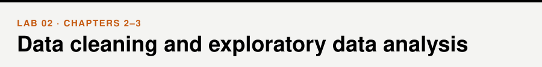

📖 *Business Intelligence and Analytics* · Chapters 2–3 &nbsp;|&nbsp; [← Lab 01](../01-python-and-pandas/) · [All labs](../README.md#labs) · [Lab 03 →](../03-visualization/)

## Walkthrough

- [Exploratory data analysis](walkthrough/01_exploratory_data_analysis.ipynb)
- [Web scraping](walkthrough/02_web_scraping.ipynb)

## Exercises

- [Data cleaning and EDA](exercises/exercises.ipynb)

## Extra (optional)

- [Bonus exercises: telecom customers](extra/bonus_exercises.ipynb)

## Datasets

[`Birthweight.csv`](../data/Birthweight.csv), [`CEO compensation.csv`](../data/CEO%20compensation.csv), [`Telco-Customer-Churn.csv`](../data/Telco-Customer-Churn.csv), [`customers.csv`](../data/customers.csv) — see the [data folder](../data/).

> [!TIP]
> **For instructors.** The scraping walkthrough is a demonstration: students should understand the idea, not reproduce all the code. `extra/bonus_exercises.ipynb` is an optional second exercise set.
