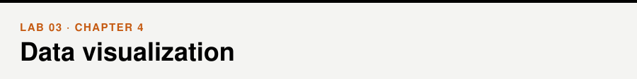
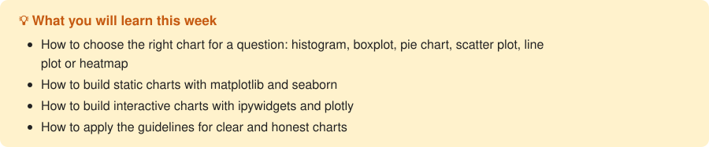

📖 *Business Intelligence and Analytics* · Chapter 4 &nbsp;|&nbsp; [← Lab 02](../02-data-cleaning-and-eda/) · [All labs](../README.md#labs) · [Lab 04 →](../04-clustering/)

## Walkthrough

- [Data visualization](walkthrough/walkthrough.ipynb)

## Exercises

- [Data visualization](exercises/exercises.ipynb)

## Datasets

[`Credit.csv`](../data/Credit.csv), [`tips.csv`](../data/tips.csv) — see the [data folder](../data/).
