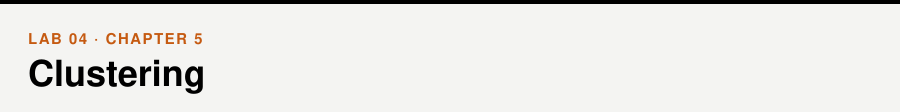
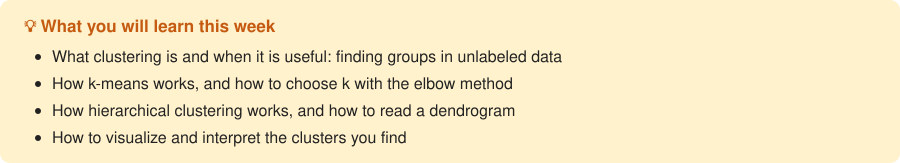

📖 *Business Intelligence and Analytics* · Chapter 5 &nbsp;|&nbsp; [← Lab 03](../03-visualization/) · [All labs](../README.md#labs) · [Lab 05 →](../05-association-rules/)

## Walkthrough

- [Clustering](walkthrough/walkthrough.ipynb)

## Exercises

- [Clustering](exercises/exercises.ipynb)

## Datasets

[`mall_customers.csv`](../data/mall_customers.csv), [`grades.csv`](../data/grades.csv) — see the [data folder](../data/).

> [!TIP]
> **For instructors.** Some exercise cells are slow (question 2 takes about 2 minutes, question 7 about 10 minutes). Students can keep working on the next questions while those cells run.
