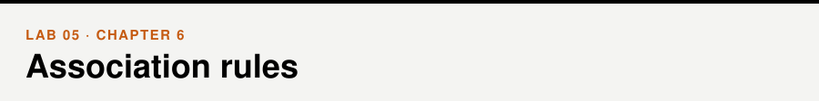
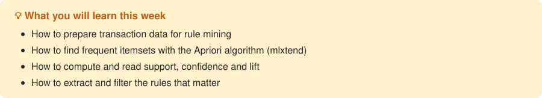

📖 *Business Intelligence and Analytics* · Chapter 6 &nbsp;|&nbsp; [← Lab 04](../04-clustering/) · [All labs](../README.md#labs) · [Lab 06 →](../06-regression-1/)

## Walkthrough

- [Association rules](walkthrough/walkthrough.ipynb)

## Exercises

- [Association rules](exercises/exercises.ipynb)

## Datasets

[`retail_dataset.csv`](../data/retail_dataset.csv), [`Groceries.csv`](../data/Groceries.csv) — see the [data folder](../data/).
