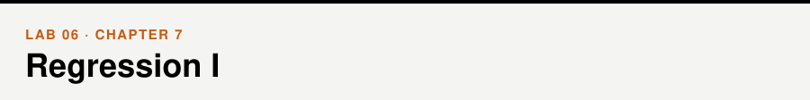
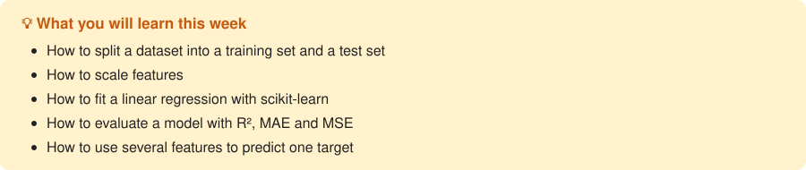

📖 *Business Intelligence and Analytics* · Chapter 7 &nbsp;|&nbsp; [← Lab 05](../05-association-rules/) · [All labs](../README.md#labs) · [Lab 07 →](../07-regression-2/)

## Walkthrough

- [Linear regression](walkthrough/walkthrough.ipynb)

## Exercises

- [Linear regression](exercises/exercises.ipynb)

## Datasets

[`weather.csv`](../data/weather.csv), [`Advertising.csv`](../data/Advertising.csv) — see the [data folder](../data/).
