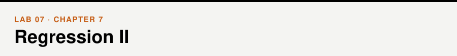
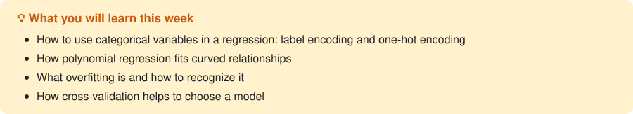

📖 *Business Intelligence and Analytics* · Chapter 7 &nbsp;|&nbsp; [← Lab 06](../06-regression-1/) · [All labs](../README.md#labs) · [Lab 08 →](../08-classification-1/)

## Walkthrough

- [Categorical variables, polynomial regression and overfitting](walkthrough/walkthrough.ipynb)

## Exercises

- [Multivariate regression, overfitting and cross-validation](exercises/exercises.ipynb)

## Datasets

[`Admissions_prediction.csv`](../data/Admissions_prediction.csv), [`Advertising.csv`](../data/Advertising.csv), [`audi.csv`](../data/audi.csv) — see the [data folder](../data/).
