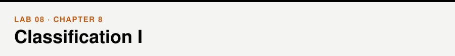
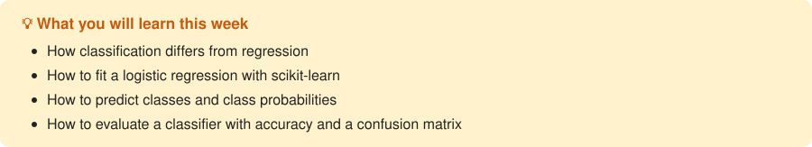

📖 *Business Intelligence and Analytics* · Chapter 8 &nbsp;|&nbsp; [← Lab 07](../07-regression-2/) · [All labs](../README.md#labs) · [Lab 09 →](../09-classification-2/)

## Walkthrough

- [Logistic regression](walkthrough/walkthrough.ipynb)

## Exercises

- [Logistic regression](exercises/exercises.ipynb)

## Datasets

[`winequality-red.csv`](../data/winequality-red.csv), [`heart.csv`](../data/heart.csv) — see the [data folder](../data/).
