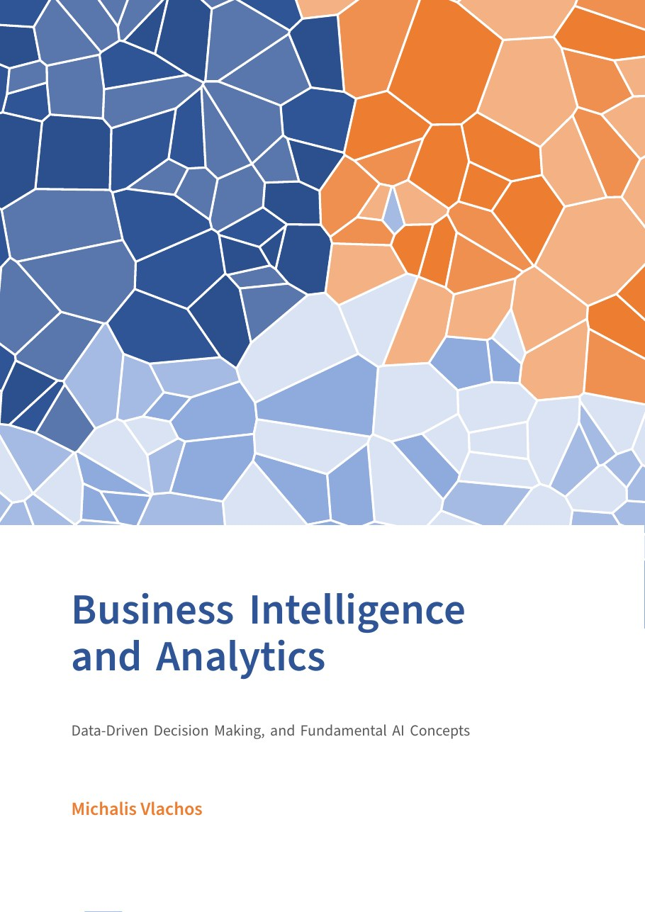
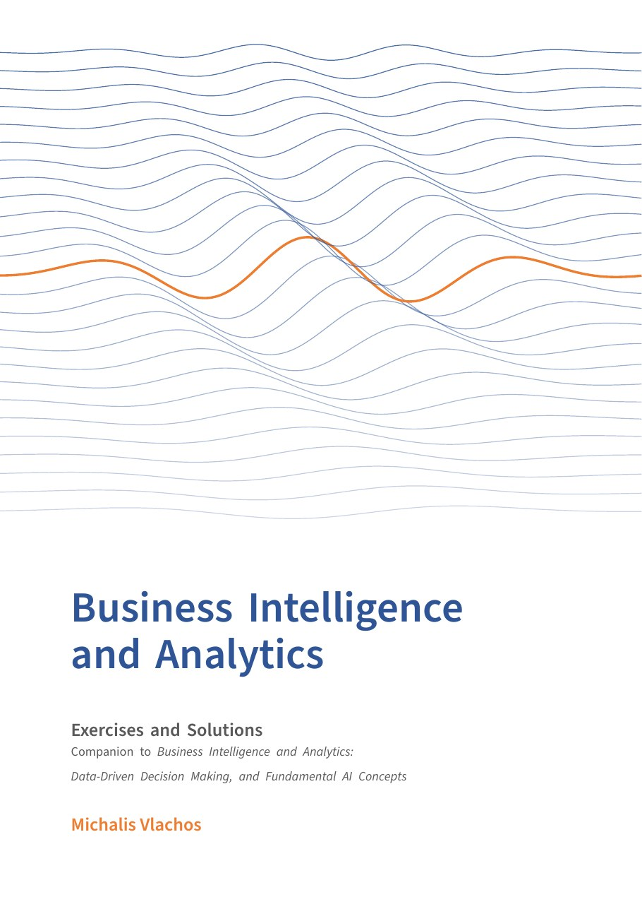

<div align="center">

<a href="https://www.amazon.fr/dp/B0HR2ZMHNJ"></a>
&nbsp;&nbsp;
<a href="https://www.amazon.fr/dp/B0HR31DQ98"></a>

# Business Intelligence and Analytics

**Python labs** for the books by Michalis Vlachos

   

[📘 Textbook](https://www.amazon.fr/dp/B0HR2ZMHNJ) · [📗 Exercises and Solutions](https://www.amazon.fr/dp/B0HR31DQ98) · [🌐 Book website](https://business-intelligence-book.github.io/Business-Intelligence-Book/)

</div>

Each lab follows a chapter of *Business Intelligence and Analytics: Data-Driven Decision Making, and Fundamental AI Concepts* and turns its ideas into working Python. Everything runs in the browser with Google Colab, so nothing needs to be installed.

> [!NOTE]
> **💡 Who is this for?**
>
> - **Readers** who want to try the methods of the book on real data.
> - **Instructors** who want ready-made lab sessions for a course built on the book. Every lab is self-contained and can be used as is, reordered or shortened.

## Labs

| Lab | Topic | Book | Walkthrough | Exercises |
|:---:|---|:---:|---|---|
| **00** | [**Getting started with notebooks**](00-getting-started/) | Basics | [](https://colab.research.google.com/github/Business-Intelligence-Book/Business-Intelligence-Book/blob/main/labs/00-getting-started/walkthrough/01_intro_to_notebooks.ipynb)<br>[](https://colab.research.google.com/github/Business-Intelligence-Book/Business-Intelligence-Book/blob/main/labs/00-getting-started/walkthrough/02_markdown_and_python.ipynb) | [2 exercises](00-getting-started/#exercises) |
| **01** | [**Python and pandas**](01-python-and-pandas/) | Ch. 1–2 | [](https://colab.research.google.com/github/Business-Intelligence-Book/Business-Intelligence-Book/blob/main/labs/01-python-and-pandas/walkthrough/01_pandas_basics.ipynb)<br>[](https://colab.research.google.com/github/Business-Intelligence-Book/Business-Intelligence-Book/blob/main/labs/01-python-and-pandas/walkthrough/02_apis.ipynb) | [](https://colab.research.google.com/github/Business-Intelligence-Book/Business-Intelligence-Book/blob/main/labs/01-python-and-pandas/exercises/exercises.ipynb) |
| **02** | [**Data cleaning and exploratory data analysis**](02-data-cleaning-and-eda/) | Ch. 2–3 | [](https://colab.research.google.com/github/Business-Intelligence-Book/Business-Intelligence-Book/blob/main/labs/02-data-cleaning-and-eda/walkthrough/01_exploratory_data_analysis.ipynb)<br>[](https://colab.research.google.com/github/Business-Intelligence-Book/Business-Intelligence-Book/blob/main/labs/02-data-cleaning-and-eda/walkthrough/02_web_scraping.ipynb) | [](https://colab.research.google.com/github/Business-Intelligence-Book/Business-Intelligence-Book/blob/main/labs/02-data-cleaning-and-eda/exercises/exercises.ipynb) |
| **03** | [**Data visualization**](03-visualization/) | Ch. 4 | [](https://colab.research.google.com/github/Business-Intelligence-Book/Business-Intelligence-Book/blob/main/labs/03-visualization/walkthrough/walkthrough.ipynb) | [](https://colab.research.google.com/github/Business-Intelligence-Book/Business-Intelligence-Book/blob/main/labs/03-visualization/exercises/exercises.ipynb) |
| **04** | [**Clustering**](04-clustering/) | Ch. 5 | [](https://colab.research.google.com/github/Business-Intelligence-Book/Business-Intelligence-Book/blob/main/labs/04-clustering/walkthrough/walkthrough.ipynb) | [](https://colab.research.google.com/github/Business-Intelligence-Book/Business-Intelligence-Book/blob/main/labs/04-clustering/exercises/exercises.ipynb) |
| **05** | [**Association rules**](05-association-rules/) | Ch. 6 | [](https://colab.research.google.com/github/Business-Intelligence-Book/Business-Intelligence-Book/blob/main/labs/05-association-rules/walkthrough/walkthrough.ipynb) | [](https://colab.research.google.com/github/Business-Intelligence-Book/Business-Intelligence-Book/blob/main/labs/05-association-rules/exercises/exercises.ipynb) |
| **06** | [**Regression I**](06-regression-1/) | Ch. 7 | [](https://colab.research.google.com/github/Business-Intelligence-Book/Business-Intelligence-Book/blob/main/labs/06-regression-1/walkthrough/walkthrough.ipynb) | [](https://colab.research.google.com/github/Business-Intelligence-Book/Business-Intelligence-Book/blob/main/labs/06-regression-1/exercises/exercises.ipynb) |
| **07** | [**Regression II**](07-regression-2/) | Ch. 7 | [](https://colab.research.google.com/github/Business-Intelligence-Book/Business-Intelligence-Book/blob/main/labs/07-regression-2/walkthrough/walkthrough.ipynb) | [](https://colab.research.google.com/github/Business-Intelligence-Book/Business-Intelligence-Book/blob/main/labs/07-regression-2/exercises/exercises.ipynb) |
| **08** | [**Classification I**](08-classification-1/) | Ch. 8 | [](https://colab.research.google.com/github/Business-Intelligence-Book/Business-Intelligence-Book/blob/main/labs/08-classification-1/walkthrough/walkthrough.ipynb) | [](https://colab.research.google.com/github/Business-Intelligence-Book/Business-Intelligence-Book/blob/main/labs/08-classification-1/exercises/exercises.ipynb) |
| **09** | [**Classification II**](09-classification-2/) | Ch. 8 | [](https://colab.research.google.com/github/Business-Intelligence-Book/Business-Intelligence-Book/blob/main/labs/09-classification-2/walkthrough/walkthrough.ipynb) | [](https://colab.research.google.com/github/Business-Intelligence-Book/Business-Intelligence-Book/blob/main/labs/09-classification-2/exercises/exercises.ipynb) |

Labs 01 and 02 also have an `extra/` folder with optional material.

## What each lab covers

### [Lab 00 · Getting started with notebooks](00-getting-started/)

- What a Python notebook is, and how to run one in Google Colab
- How to format text with Markdown: headings, lists, links, images, tables and formulas
- How to run your first lines of Python

### [Lab 01 · Python and pandas](01-python-and-pandas/)

- How to load CSV and JSON files into a pandas DataFrame
- How to inspect a dataset: number of rows and columns, data types, missing values
- How to select columns, convert types, group values and save the result
- What an API is, and how to get data from one

### [Lab 02 · Data cleaning and exploratory data analysis](02-data-cleaning-and-eda/)

- How to get a first look at a dataset: data types and descriptive statistics
- How to find and handle missing data
- How to use histograms, boxplots, scatter plots and heatmaps to find patterns and correlations
- What web scraping is, and how to collect a table from a web page

### [Lab 03 · Data visualization](03-visualization/)

- How to choose the right chart for a question: histogram, boxplot, pie chart, scatter plot, line plot or heatmap
- How to build static charts with matplotlib and seaborn
- How to build interactive charts with ipywidgets and plotly
- How to apply the guidelines for clear and honest charts

### [Lab 04 · Clustering](04-clustering/)

- What clustering is and when it is useful: finding groups in unlabeled data
- How k-means works, and how to choose *k* with the elbow method
- How hierarchical clustering works, and how to read a dendrogram
- How to visualize and interpret the clusters you find

### [Lab 05 · Association rules](05-association-rules/)

- How to prepare transaction data for rule mining
- How to find frequent itemsets with the Apriori algorithm (`mlxtend`)
- How to compute and read support, confidence and lift
- How to extract and filter the rules that matter

### [Lab 06 · Regression I](06-regression-1/)

- How to split a dataset into a training set and a test set
- How to scale features
- How to fit a linear regression with scikit-learn
- How to evaluate a model with R², MAE and MSE
- How to use several features to predict one target

### [Lab 07 · Regression II](07-regression-2/)

- How to use categorical variables in a regression: label encoding and one-hot encoding
- How polynomial regression fits curved relationships
- What overfitting is and how to recognize it
- How cross-validation helps to choose a model

### [Lab 08 · Classification I](08-classification-1/)

- How classification differs from regression
- How to fit a logistic regression with scikit-learn
- How to predict classes and class probabilities
- How to evaluate a classifier with accuracy and a confusion matrix

### [Lab 09 · Classification II](09-classification-2/)

- How the k-nearest neighbors classifier works, and why features must be normalized
- How a decision tree makes its predictions
- How to compare classifiers on a test set

## How each lab works

Every lab has the same structure:

1. **What you will learn this week.** Each lab page and each notebook opens with the goals of the session.
2. **Walkthrough.** A guided notebook that shows the method step by step on a real dataset.
3. **Exercises.** A notebook with gaps to fill in. Questions marked ✅ **Checkpoint question** are the ones to get right before moving on.
4. **Extra** (some labs). Optional material for going further.

## Getting started

1. Open a lab from the table above and click the **Open in Colab** badge.
2. In Colab, choose **File → Save a copy in Drive**. Otherwise your changes are lost when you close the tab.
3. Run the cells from top to bottom. The datasets load directly from the [`data/`](data/) folder.

To run the notebooks on your own computer instead, install Python 3.10 or later, then run `pip install -r requirements.txt` and `jupyter lab`.

> [!TIP]
> **For instructors**
>
> - Each lab is built for one session: a walkthrough that you present, followed by exercises that students solve alone or in small groups.
> - The ✅ checkpoint questions can be copied into the quiz tool of your teaching platform.
> - To adapt the notebooks, fork the repository. Replace `Business-Intelligence-Book/Business-Intelligence-Book` in the badge links and data URLs so that the notebooks use your fork.
> - Presentation slides for every chapter are available from the [book website](https://business-intelligence-book.github.io/Business-Intelligence-Book/).

## Repository structure

```
labs/
  README.md                  this page
  00-getting-started/        one folder per lab
    README.md                goals, notebooks, datasets
    walkthrough/             guided notebook(s)
    exercises/               exercise notebook(s)
    extra/                   optional material (some labs)
  data/                      the datasets used in the labs
  requirements.txt           Python packages, to run the labs locally
```

## Citation

If you use these labs in your teaching, please cite the textbook:

> Vlachos, M. (2026). *Business Intelligence and Analytics: Data-Driven Decision Making, and Fundamental AI Concepts.*
